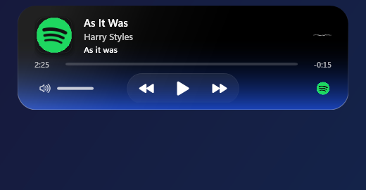
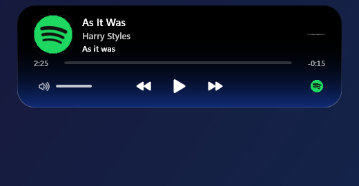
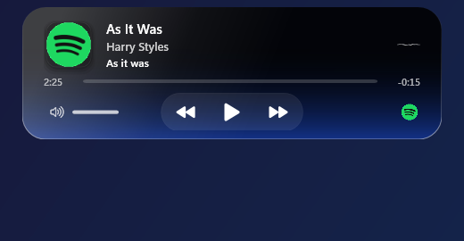
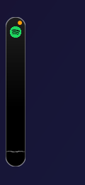
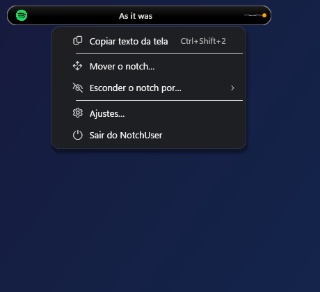
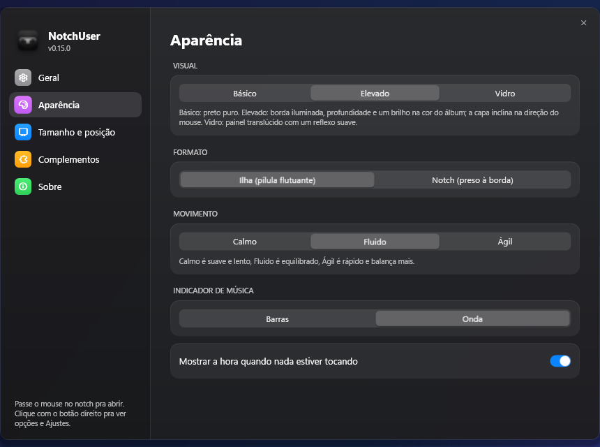
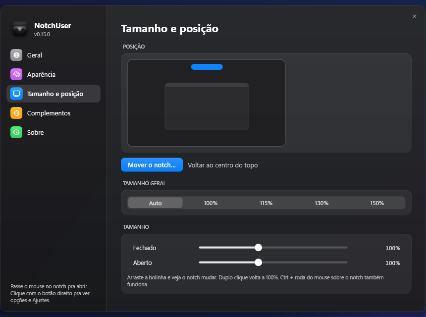

<p align="center">
  
</p>

<h3 align="center">A ilha do Mac, no seu Windows.<br>Sua música, seus arquivos e seus atalhos numa pílula que flutua onde você quiser.</h3>

<p align="center">
  <a href="../../releases/latest"><b>⬇ Baixar o NotchUser.exe</b></a>
  &nbsp;·&nbsp; 1 arquivo, sem instalador
  &nbsp;·&nbsp; grátis e de código aberto (MIT)
  &nbsp;·&nbsp; sem telemetria
</p>

<p align="center">
  
</p>

> Versão para Mac: [Magnumja/NotchUser](https://github.com/Magnumja/NotchUser) · Linux (GNOME): [Magnumja/NotchUser-Linux](https://github.com/Magnumja/NotchUser-Linux)

## Por que testar

- **Parece nativo e se mexe como uma gota.** Molas de verdade (as mesmas do Mac), cantos que se arredondam ao abrir, o painel que "nasce" aos poucos e uma pílula que se estica na direção em que você a arrasta.
- **Você escolhe onde ele fica.** No topo, embaixo ou nas laterais, em qualquer ponto da borda e em qualquer monitor. Nas laterais ele fica em pé, como uma pílula vertical.
- **Não atrapalha seus jogos.** Desenhado pelo processador (a placa de vídeo fica livre), some em tela cheia e entra no modo de eficiência do Windows enquanto o jogo roda.
- **Funciona com o que você já usa.** Spotify, YouTube no Chrome, Edge, Firefox, Media Player: tudo que aparece nos controles de mídia do Windows.
- **É seu.** Três visuais, três velocidades de movimento, dois tamanhos independentes, três idiomas (português, inglês e espanhol). Nada sai do seu PC a menos que você ligue.

## Três visuais

<table>
  <tr>
    <td align="center"><br><b>Básico</b><br>preto puro</td>
    <td align="center"><br><b>Elevado</b><br>borda iluminada, relevo e o brilho do álbum</td>
    <td align="center"><br><b>Vidro</b><br>painel translúcido com reflexo</td>
  </tr>
</table>

Nenhum usa desfoque nem sombra ao vivo: tudo é gradiente e camadas translúcidas, para continuar leve.

## Mova para onde quiser

<table>
  <tr>
    <td></td>
    <td></td>
    <td>Clique com o botão direito, <b>Mover o notch…</b>, segure e arraste. Ele gruda na borda mais próxima com um quique, e vira uma pílula em pé nas laterais.<br><br>Prefere pelos Ajustes? Há uma <b>tela em miniatura</b>: clique ou arraste dentro dela e o notch de verdade acompanha.</td>
  </tr>
</table>

## O que ele faz

- **Música:** capa, título, artista, barra de progresso (arraste para pular), voltar, tocar e avançar. A cor do álbum pinta o brilho e o contorno. Se o player não manda capa, o ícone do app entra no lugar, nunca um quadrado vazio.
- **Abre como você quiser:** passando o mouse, com um clique (bom para touchpad e telas de toque) ou pelo teclado.
- **Prateleira de arquivos:** arraste arquivos, links ou texto até o topo; o notch abre antes de você chegar na borda. Miniaturas reais, seleção múltipla, arrastar para fora. Clique direito: **compactar em ZIP**, **converter imagem para PNG ou JPEG** e **reduzir à metade**.
- **Volume e brilho:** o nível aparece no notch, e a roda do mouse sobre ele muda o volume.
- **Avisos:** carregador, bateria fraca, troca de fone, Caps Lock e Num Lock, e o pontinho verde ou laranja de câmera e microfone em uso.
- **Dois tamanhos independentes:** o notch fechado e o aberto, de 60% a 160%, com barras com bolinha nos Ajustes. Ctrl + roda do mouse ajusta na hora.
- **Esconder:** por 15 minutos, 1 hora, ou até você abrir o NotchUser de novo. Também dá para fazer a pílula sumir sozinha quando não há nada a mostrar.

<p align="center">
  
</p>

O menu do clique direito é curto de propósito. Tudo o mais fica nos **Ajustes**, organizados em Geral, Aparência, Tamanho e posição, Complementos e Sobre:

<table>
  <tr>
    <td></td>
    <td></td>
  </tr>
</table>

## Complementos (desligados até você ligar)

- **Copiar texto da tela** (`Ctrl+Shift+2`): arraste sobre qualquer pedaço da tela e o texto vai para a área de transferência. Usa o reconhecimento de texto do próprio Windows, sem internet, e a imagem não é salva.
- **Letras sincronizadas:** a linha cantada aparece no notch, na cor do álbum, com letras do [LRCLIB](https://lrclib.net) (gratuito e aberto).
- **Abrir e fechar pelo teclado** (`Ctrl+Alt+N`).
- **Silenciar o microfone** (`Ctrl+Alt+M`), com aviso no notch.
- **Procurar atualizações** uma vez por dia.

## Privacidade

Nada de telemetria, conta ou anúncios. Só dois recursos falam com a internet, e ambos começam desligados: as letras (enviam o nome da música, o artista, o álbum e a duração ao LRCLIB) e a procura por atualizações (uma consulta ao GitHub). Seus ajustes e a prateleira ficam em `%AppData%\NotchUser`, gravados de forma segura: se um arquivo estragar, ele vira `.bak` e o app abre com o padrão.

## Como começar

1. Baixe o `NotchUser.exe` em [Releases](../../releases/latest).
2. Abra. Não precisa instalar nada, nem o .NET.
3. Na primeira vez o Windows pode avisar "O Windows protegeu o computador": clique em **Mais informações → Executar assim mesmo** (o app não é assinado por um certificado pago).
4. Passe o mouse no topo da tela. Clique com o botão direito para as opções e os Ajustes.

Requisitos: Windows 10 (2004) ou Windows 11. Abrir o NotchUser de novo, a qualquer momento, abre os Ajustes (e traz o notch de volta se você o tiver escondido).

## Perguntas rápidas

**Perde FPS nos jogos?** Não deve: ele é desenhado pelo processador, a janela é do tamanho da pílula enquanto está fechado, e em tela cheia ele sai de cena e põe o app em modo de eficiência.

**A capa não aparece.** Alguns players mandam a capa com atraso, e o NotchUser tenta de novo algumas vezes. Se o player nunca manda, o ícone dele fica no lugar.

**Cobre a barra de tarefas?** Não: nas bordas de baixo e dos lados ele encosta na área útil da tela.

**Funciona com vários monitores?** Sim: escolha a tela, ou deixe o notch seguir o mouse até a borda de cima de outro monitor.

## Rodar a partir do código

1. Instale o **.NET 8 SDK**: https://dotnet.microsoft.com/download/dotnet/8.0
2. No PowerShell, dentro desta pasta:

```powershell
dotnet run
dotnet test tests/NotchUser.Tests      # 19 testes
```

Para gerar um `NotchUser.exe` único, que roda sem instalar o .NET:

```powershell
dotnet publish -c Release -r win-x64 --self-contained true -p:PublishSingleFile=true -p:IncludeNativeLibrariesForSelfExtract=true -p:EnableCompressionInSingleFile=true -p:DebugType=none -o dist
```

Para conferir sem mexer no mouse: `NotchUser.exe --show-open` abre já com o painel aberto, `--show-menu` com o menu e `--settings=layout` com os Ajustes numa seção.

## Arquivos

- `MainWindow.xaml` / `.cs`: o notch, o painel, o movimento e o menu.
- `Visuals.cs`, `Spring.cs`: formas, barrinhas, ondas e as molas.
- `SettingsWindow.cs`, `Ui.cs`, `MenuControls.cs`, `OnboardingWindow.cs`: Ajustes, a apresentação e as peças visuais (estilos em `App.xaml`).
- `MediaService.cs`, `Volume.cs`, `Brightness.cs`, `Power.cs`, `Privacy.cs`: música, som, brilho, bateria e câmera/microfone.
- `Shelf.cs`, `ShelfActions.cs`, `ShellImage.cs`: a prateleira, o ZIP e a conversão de imagens.
- `Displays.cs`, `FullScreen.cs`, `Native.cs`: telas, tela cheia e chamadas do Windows.
- `ScreenText.cs`, `Lyrics.cs`, `Updater.cs`, `Settings.cs`, `Strings.cs`: texto da tela, letras, atualizações, ajustes e idiomas.
- `tests/NotchUser.Tests`: os testes.

## Licença

[MIT](LICENSE).
